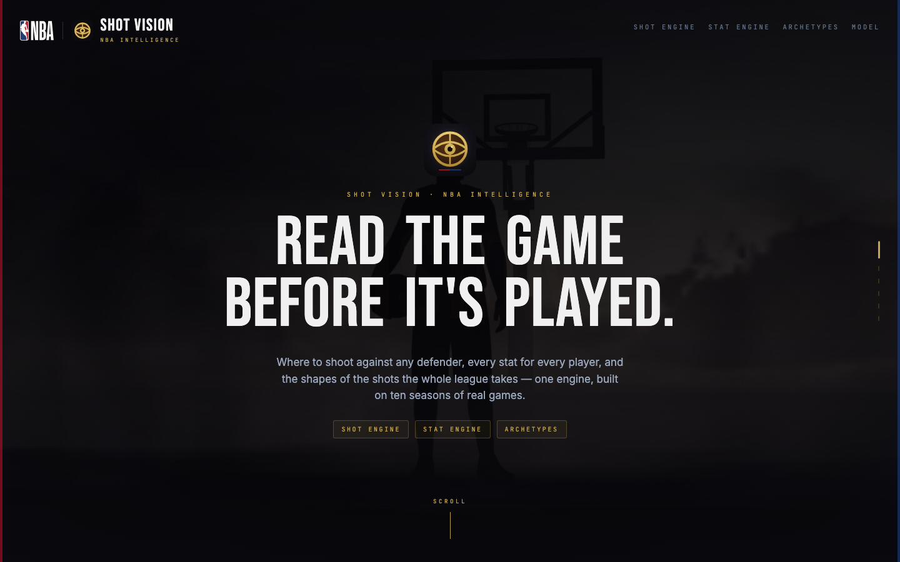
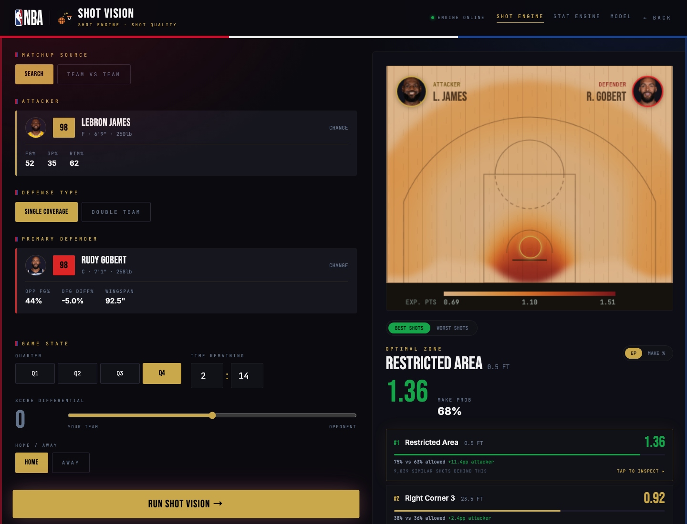
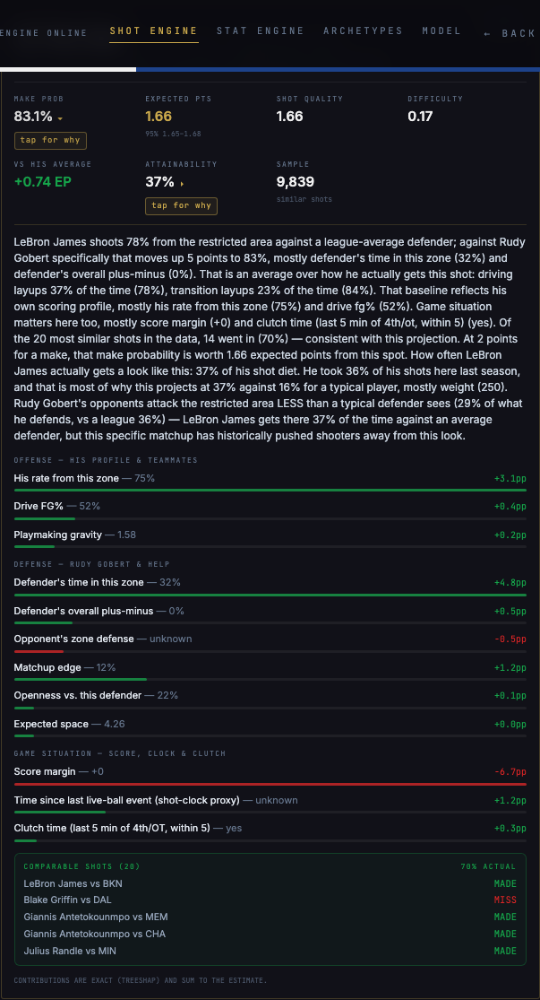
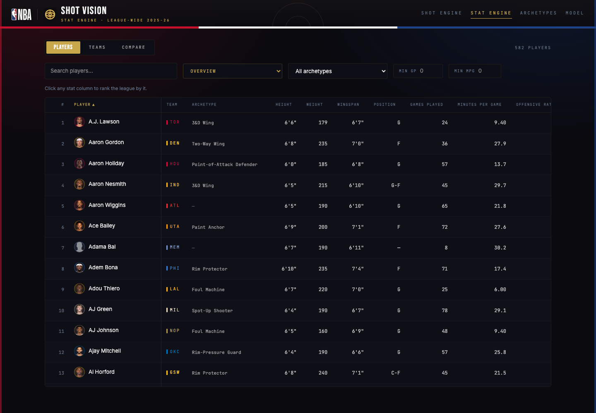
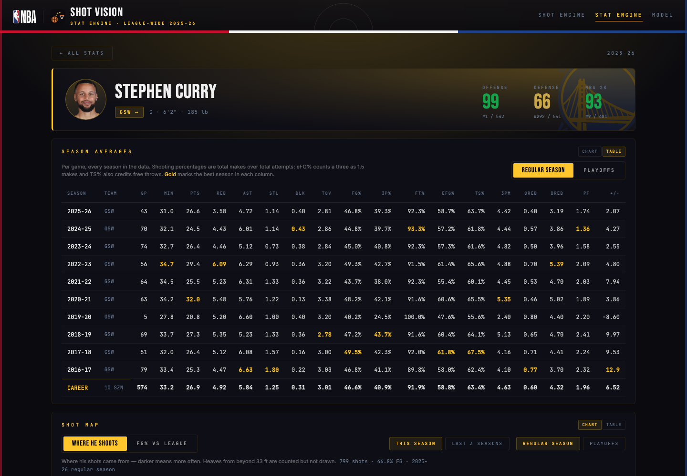
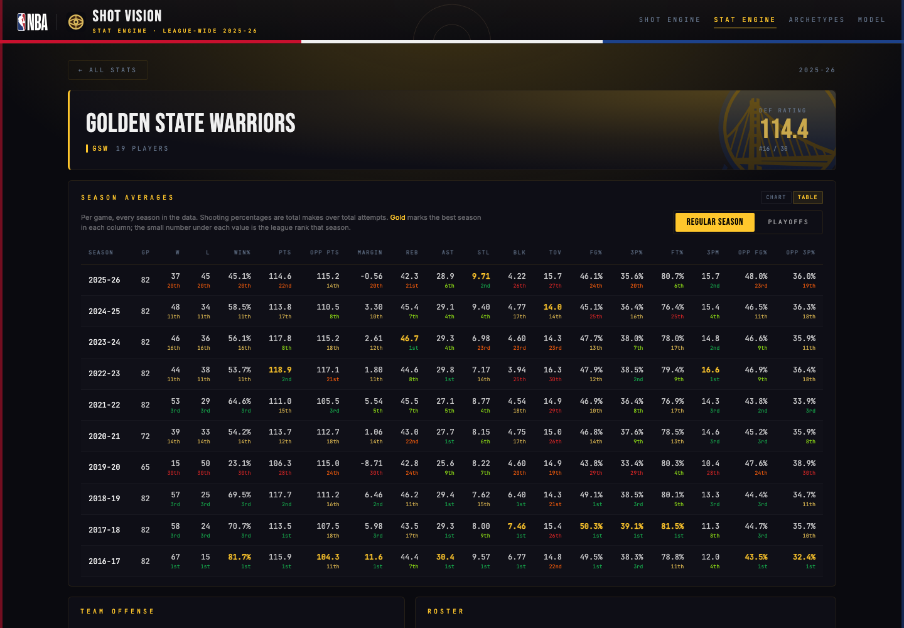
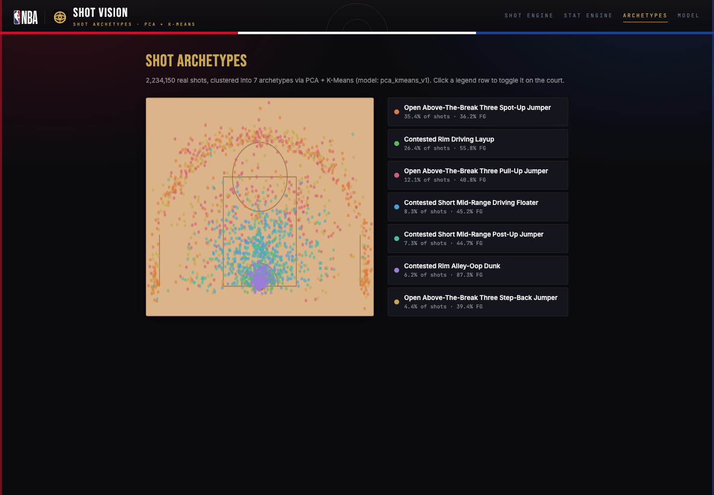

# SHOT VISION — NBA Shot Quality & Analytics Platform

An NBA analytics app built on 3.5 million shots and every player's and team's box
score. It has three parts:

- **Shot Engine** — pick a shooter and the defender on him, and two XGBoost
  models score every spot on the floor: how likely the shot is to go in, and how
  readily this player can actually get it. Every number explains itself.
- **Stat Engine** — a SofaScore-style browser over 580+ players and all 30
  teams: league ranks, career trends, season-by-season averages, head-to-head
  comparisons and player archetypes.
- **Shot Archetypes** — 2.2 million shots clustered into the seven kinds of shot
  the league actually takes.

FastAPI backend, React + TypeScript frontend.



## The Shot Engine

Ranking shot locations by expected points alone recommends the restricted area to
every player on earth — true, and useless, since the rim is the most efficient
spot on the floor for everyone and the whole difficulty is *getting* there. So
the engine pairs two questions:

1. **Shot quality** — P(make | a shot is taken from here), given the shooter, the
   named defender, who else is on the floor, and the game situation (score,
   clock, clutch time).
2. **Attainability** — what share of *this player's* shot diet plausibly comes
   from here, i.e. how readily he can generate the look, computed point-in-time
   from his season so far, his career and his last season.

The two are reported separately and combined into a ranking, so the interface can
tell "a great shot for you" apart from "a shot you can actually get". Results
show the best zones and, at the flip of a toggle, the worst.



### Every number explains itself

Click any shot and its make probability opens into a full breakdown: a
plain-English paragraph, then every factor that moved the number, grouped into
the shooter's own profile, the defender and help defense, and the game situation.
The contributions are exact TreeSHAP values, so they add up to the prediction
rather than approximating it.

Underneath sits a **comparable-shots check**: the real past shots most similar to
this one, found by nearest-neighbour search over the model's own feature space,
and how often they went in. When that record disagrees with the model, the
explanation says so instead of hiding it.



## The Stat Engine

Every stat the project collects — box score, shooting by zone, play types,
creation, defense by shot type, hustle stats — for every player and team, ranked
against the league and colour-coded by tier.



Profiles carry **season-by-season averages** of the major stats: regular season
and playoffs separately, a career line, and each column's best season picked out.
Shooting percentages are total makes over total attempts, so they match the NBA's
own numbers.



Team profiles add the opponents' line and the team's **league rank in every stat,
every season**.



Also on player profiles: a radar of the player's shape across six areas, a
strengths-and-weaknesses chart, career trend lines, shot charts by zone, play-type
and defense-by-category charts, and a rule-based player archetype ("Two-Way Wing",
"Rim Protector"…) with its definition one click away. Any two or three players
can be compared side by side. Every chart has a table view.

## Shot archetypes

PCA + K-Means over 2.2 million shots finds seven archetypes — from the open
above-the-break spot-up three (35% of all shots, 36% FG) to the contested alley-oop
dunk (6%, 87% FG) — drawn on the court.



## How good is the model

`shot-quality-v20` (120 features), tested on the 2025-26 season, which it never
trained on — 228,832 shots:

| Metric | Value |
|---|---|
| AUC | 0.707 |
| Log-loss | 0.611 |
| Calibration error (ECE) | 0.008 |
| Zone-rank correlation, per player | 0.741 across 349 players |

The calibration error is the one that matters most here: when the model says a
shot goes in 40% of the time, it goes in about 40% of the time. The full
version-by-version record — every number, every rejected feature, every ablation —
is in [`docs/model-versions.md`](docs/model-versions.md).

## What was actually hard here

- **The same leak was found and fixed twice, independently.** The original
  pipeline joined whole-season aggregates onto every shot in that season, so a
  shot's own outcome was inside its own feature. Fixed for shooters first,
  rediscovered for defenders later — `defender_stats` was still being joined by
  season alone. Both fixes required rebuilding the rate as a strictly
  prior-games-only, empirical-Bayes-shrunk quantity, computed identically at
  training and serving time.
- **A model can look free to cut and still be load-bearing.** Group ablation on
  the shot-quality model showed removing `shooter_skill` costs almost nothing in
  log-loss — but tanks zone-rank correlation from 0.740 to 0.727, the worst
  regression in the table. A single-metric read would have thrown out the thing
  that makes per-player rankings mean anything.
- **The attainability model was leaning on the wrong data for over a season and
  a half of iteration.** It had no access to a player's own shot diet — the
  single strongest predictor available (season-over-season autocorrelation
  0.94) — and it trained only on completed seasons, so it couldn't see the
  *current* season at all. Twenty games of live evidence turned out to predict a
  player's rest-of-season shot diet better than his entire previous year.
  Restructuring the model to be genuinely point-in-time fixed both at once and
  produced the largest single accuracy gain in the project.
- **A leave-one-out feature was necessary, not optional.** Naively adding "how
  well does this player's team move the ball" credits a ball-dominant star with
  his *own* teammates' passing stats — Oklahoma City ranked 27th of 30 in team
  assist rate largely because Shai Gilgeous-Alexander creates so much of his own
  offense; strip him out and his actual teammates rank near the top of the
  league. Every team-context feature subtracts the player's own contribution
  before it reaches the model.
- **An explanation is a claim, and claims can be wrong in ways a metric won't
  catch.** Reading generated output by hand — not just checking that a number
  moved — caught real bugs in the natural-language explanations: a player's own
  history attributed to "his game", a rate computed *this season* labelled "last
  season", and a 0.2% share rendering as "0%" next to a nonzero number in the
  same sentence.

## Architecture

Module-by-module breakdown in [`docs/architecture.md`](docs/architecture.md).

```
nba_api → ingestion/ (28 scripts) → SQLite (21 tables, 3.5M shots, 16 seasons)
                                          │
                                          ▼
                             features/  (point-in-time, shrunk, leak-free —
                                         ONE definition, shared by training
                                         and serving)
                                          │
                                          ▼
                     training/  (shot quality + attainability, XGBoost,
                                  validated by feature-group ablation and
                                  rolling-origin backtests)
                                          │
                                          ▼
                      inference/  (FastAPI — same feature code, TreeSHAP
                                    explanations, comparable shots,
                                    Stat Engine, season averages)
                                          │
                                          ▼
                    shot-vision-engine-main/  (React / TanStack Start)
```

The guarantee the codebase is built around: `src/features/spec/` computes every
derived feature exactly once, and both the training-matrix builder and the live
recommender call the same function. `tests/test_train_serve_parity.py` asserts the
two paths agree on identical input — the failure it exists to catch already
happened once, silently, before this layer existed.

Alongside the main pipeline: a Kafka path that scores shots as live events
([`docs/streaming.md`](docs/streaming.md)), a PySpark reimplementation of the
point-in-time features (`spark_jobs/`), and R scripts that cross-check the
defender signal (`r/`).

## Running it

```bash
pip install -r requirements.txt
python -c "from src.db.database import init_db; init_db()"

# Ingest data (see COMMANDS.md for the full, resumable pipeline —
# a full bootstrap across 10+ seasons takes several hours)
python -m src.ingestion.bootstrap --full
python -m src.ingestion.game_log_ingestor          # box scores, for season averages

# Train both models
python -m src.training.train --name shot-quality-v20
python -m src.training.attainability --name attainability-pit

# Build the comparable-shots index (optional; without it the
# explanation simply omits that section)
python -m src.training.build_comparable_index --model shot-quality-v20

# Run it
./scripts/dev.sh

# During the season: pull every game since the last refresh, in one step
python scripts/refresh_season.py
```

`./scripts/dev.sh` starts the FastAPI backend and the React frontend on fresh
ports, wires them together, and prints the URLs. Tests: `pytest` (271 tests;
`pytest -m "not slow"` skips the ones that need trained models and the full
database). See [`COMMANDS.md`](COMMANDS.md) for every ingestion step, ablation
flag and evaluation tool.

**Speed.** `python scripts/benchmark_latency.py --api <backend URL>` times the
two requests the engine makes against a running server. Scoring the whole court
for a matchup takes about 0.2 s and a full shot explanation about 0.35 s,
median over six matchups (up to ~0.7 s the first time a player's data is read
from disk). Both used to take around 2 s; almost all of that was SQL scanning a
player's or team's full history, fixed with two covering indexes and queries
that narrow to the right games before reading any shots.

## Stack

**Backend:** Python, XGBoost, scikit-learn, FastAPI, SQLAlchemy, SQLite + DuckDB,
pandas/numpy
**Frontend:** React, TypeScript, TanStack Start
**ML:** point-in-time feature engineering, empirical-Bayes shrinkage, monotone
constraints, TreeSHAP explanations, nearest-neighbour precedent, PCA + K-Means,
rolling-origin backtesting
**Also:** Kafka, PySpark, R

## Documentation and roadmap

- [`docs/project_overview.md`](docs/project_overview.md) — end-to-end overview
- [`docs/architecture.md`](docs/architecture.md) — module-by-module breakdown
- [`docs/model-versions.md`](docs/model-versions.md) — full version history,
  every measured number, everything tried and rejected
- [`docs/redesign.md`](docs/redesign.md) — the feature-layer redesign and what it
  changed
- [`COMMANDS.md`](COMMANDS.md) — complete command reference
- [Roadmap](https://github.com/users/srikarreddyram/projects/2) — what's shipped
  and what's next
